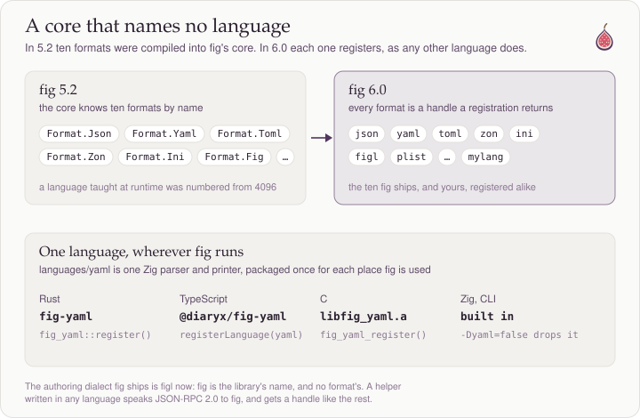
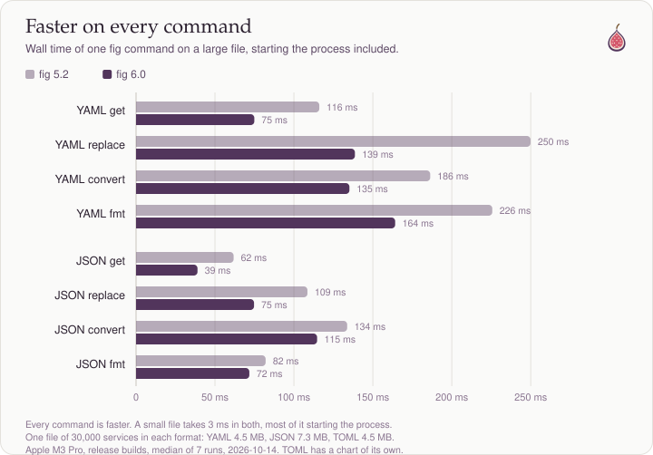
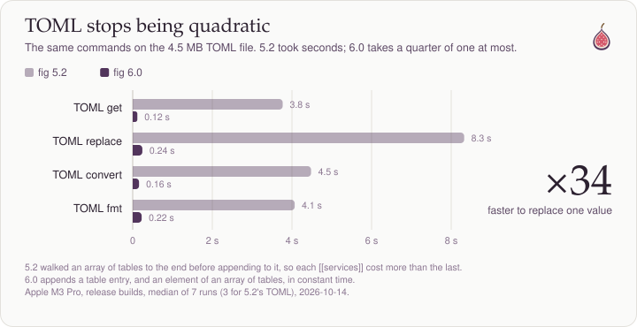
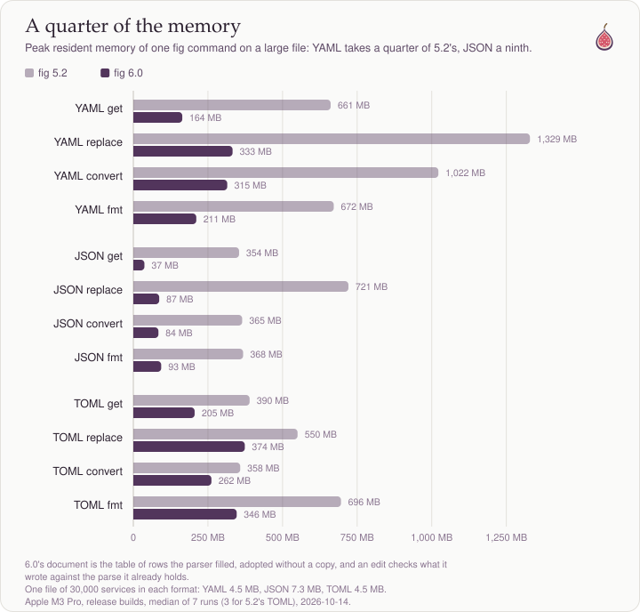
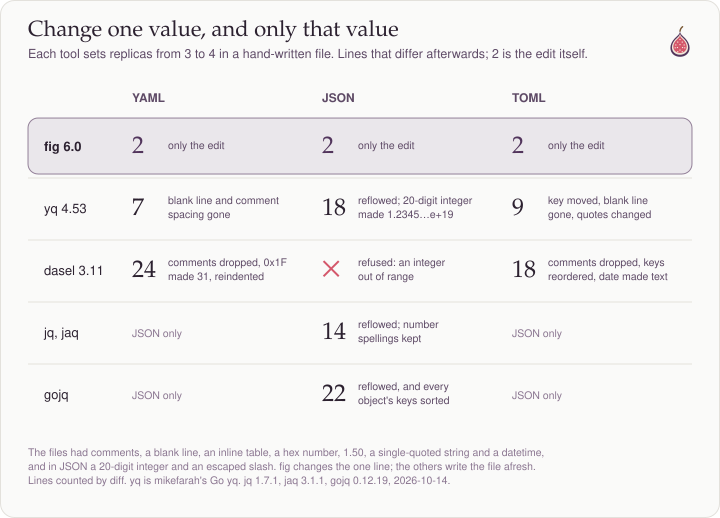

```fig
title = Version 6.0.0
part_of = [Devlogs](../devlogs.md)
author = adammharris
created = 2026-10-14
contents = []
attachments = [{ content = /docs/devlogs/6-0-0/6-0-0-memory.svg, title = A quarter of the memory, content_hash = sha256:56b2582576825b3cd0ccd944dfc7e9bbbdd8c661bfc9041f325409f2b99da608 }, { content = /docs/devlogs/6-0-0/6-0-0-core.svg, title = A core that names no language, content_hash = sha256:d449f654ca57148f284fe7f4b0a355d44ba9b97ea2eeabec58c47459dce8ce01 }, { content = /docs/devlogs/6-0-0/6-0-0-fidelity.svg, title = 'Change one value, and only that value', content_hash = sha256:fb599cecee5b843c02cfde67e6ddb8471447b17633f6cb2dacc19ab8a9ea403c }, { content = /docs/devlogs/6-0-0/6-0-0-speed.svg, title = Faster on every command, content_hash = sha256:a268d53e3afb52036ddd3c678743e5ae2974cefceb123eadfed9f32ca642a991 }, { content = /docs/devlogs/6-0-0/6-0-0-toml.svg, title = TOML stops being quadratic, content_hash = sha256:8367c86a29a3086175c498bc3ed12c21033c96e31e2e2e6cb089fd65f02d3145 }]
```

# `fig` version 6.0.0

A new major version for Fig, but still under the "Texas Everbearing" epoch. Rather than go a new direction, it takes the ideas behind the previous epoch even farther.

In the [previous devlog](../2-texas-everbearing/2-texas-everbearing.md), I added the ability for Fig to understand different languages at runtime. In Fig 6, the core now knows nothing about any specific format. Consumers must use separate language modules like `fig-json`.



Typically, this would slow down performance, but thanks to the new design, this actually increased performance in nearly all cases.


## Faster on every command

In 5.2, a language's parse handed back its own table of 144-byte rows, and Fig copied it into a tree.
In 6.0 the table *is* the document: 32-byte rows that the language fills through Fig's calls, adopted as they stand with no copy.

For runtime languages, the only copy is across the RPC layer. For compiled languages, copies and allocations are near the floor. JSON in particular has now become a pull parser, making Fig parsing time competitive with `jq` and `jaq`.

| | get | replace |
|---|---|---|
| fig 6.0 | 0.039 s · 37 MB | 0.081 s · 87 MB |
| jaq 3.1 | **0.033 s** · 62 MB | 0.087 s · **62 MB** |
| gojq 0.12 | 0.060 s · 46 MB | 0.101 s · 60 MB |
| jq 1.7.1 | 0.141 s · 55 MB | 0.312 s · 58 MB |




These are files of 30,000 services each (YAML 4.5 MB, JSON 7.3 MB), timed from process start.
On a small file, both versions take about 3 ms, most of it starting the process.

5.2 had a TOML bug where appending to an array of tables walked the whole array first, so every `[[services]]` cost more than the one before it.
On a 4.5 MB file that is seconds per command.
6.0 appends in constant time, and replacing one value is 34× faster.



YAML takes about a quarter of the memory it took before, and JSON about a ninth.



## Change one value, and only that value

The purpose of Fig is to have the smallest possible programmatically driven diffs.

Here is a diff comparison with Fig and other tools:



Fig has the smallest possible diff at 2 lines.
yq loses a blank line and a comment in YAML, and in JSON turns the 20-digit integer into `1.2345…e+19`.
dasel drops comments and turns `0x1F` into `31`, and refuses the JSON file outright.
jq and jaq keep every number as written, but reflow the whole file, and gojq sorts every object's keys too.

## Conclusion

My next goal is to make Twig depend on Fig. I have made some changes to prepare for this:
- Embed functionality has been taken out of Fig, and belongs in Twig.
- `.fig` is not an accepted filename—only `.figl`
- As said before, Fig by itself no longer parses anything on its own.
- Fig now depends on a JSON-RPC 2.0 library (its first ever dependency).

It will be great, trust me!

Please enjoy the new update!
